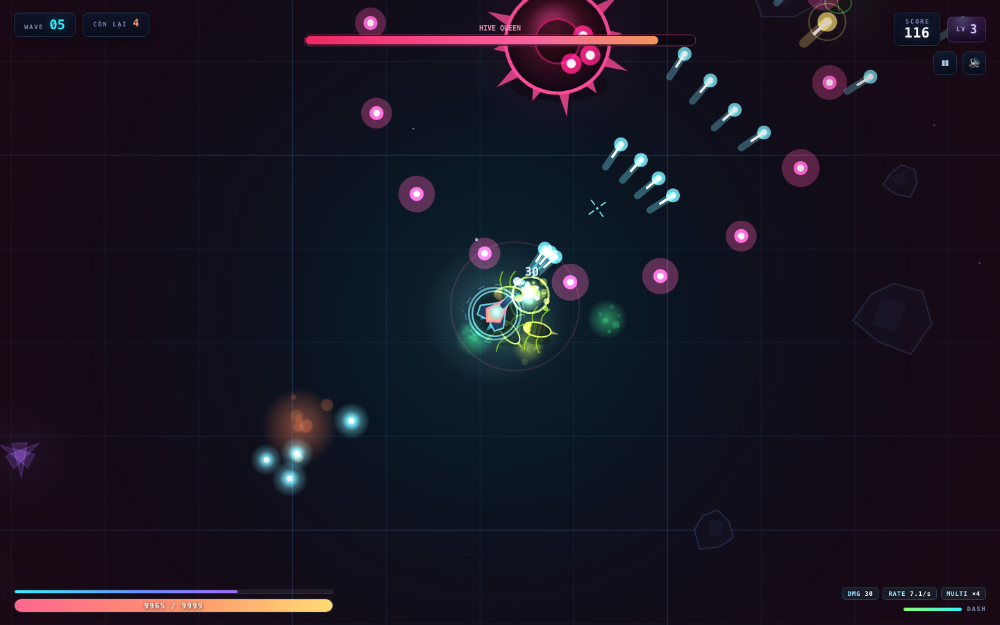

# ALIEN SHOOTER — Neon Arena

Game bắn súng sinh tồn góc nhìn từ trên xuống (top-down arena shooter), chạy **hoàn toàn trong trình duyệt** — không cần cài đặt, không cần internet, không dùng thư viện ngoài.

Bạn là người sống sót cuối cùng ở thuộc địa XR-7. Sinh vật ngoài hành tinh tràn ra từ các tổ theo từng đợt. Bắn, lướt né, nhặt XP, chọn nâng cấp và sống sót càng lâu càng tốt.


---

## Chạy game

**Cách 1 — mở trực tiếp:** nhấp đúp vào `index.html` (hoặc kéo thả vào Chrome / Safari / Edge / Firefox).

**Cách 2 — chạy qua local server** (nếu trình duyệt chặn file local):

```bash
cd alien-shooter
python3 -m http.server 8080
# mở http://localhost:8080
```

Không cần build, không cần `npm install`.

---

## Điều khiển

| Desktop | Hành động |
|---|---|
| `W` `A` `S` `D` / phím mũi tên | Di chuyển |
| Chuột | Ngắm |
| Giữ chuột trái | Bắn (tự động theo nhịp) |
| `Space` | Lướt né — bất tử 0.3s, có hồi chiêu |
| `P` / `Esc` | Tạm dừng |
| `M` | Bật / tắt tiếng |
| `1` `2` `3` | Chọn nâng cấp khi lên cấp |
| `R` | Chơi lại (ở màn hình thua) |

**Trên điện thoại / tablet:** nửa trái màn hình là joystick di chuyển, nửa phải là joystick ngắm (giữ là tự bắn), nút **DASH** ở góc phải để lướt. Nút ⏸ / 🔊 ở góc phải trên.

---

## Gameplay

- **Đợt (wave) vô hạn**, độ khó tăng dần: nhiều alien hơn, máu dày hơn, nhanh hơn.
- **5 loại sinh vật:**
  - 🟢 **Crawler** — bò thẳng tới bạn, yếu nhưng đông.
  - 🟡 **Skitter** — chạy nhanh, zic-zac, rất khó trúng.
  - 🟣 **Spitter** — giữ khoảng cách và phun axit (có dấu hiệu tụ năng lượng trước khi bắn).
  - 🟠 **Brute** — trâu bò, giáp dày, chết sẽ tách ra 2 Crawler.
  - 💗 **Boss** — mỗi **5 đợt**, có 4 chiêu: bắn vòng tròn, bắn 3 tia nhắm thẳng, gọi đệ, lao thẳng vào bạn.
- **XP & nâng cấp:** hạ gục alien rơi XP; lên cấp thì chọn 1 trong 3 nâng cấp ngẫu nhiên.
  Có **16 nâng cấp** chia 2 nhóm: chỉ số (sát thương, tốc độ bắn, multi-shot, xuyên phá, chí mạng, máu, hồi máu, tốc chạy, từ trường hút XP…) và nâng cấp hiếm (đạn nổ, sóng xung kích khi lướt, drone hộ tống).
- **Điểm số:** hạ gục + thưởng dọn đợt. **Kỷ lục** được lưu vào `localStorage`.
- **Chiến thuật:** giữ khoảng cách, ưu tiên Spitter, dùng dash để né đạn và xuyên qua đám đông. Nhặt XP để lên cấp — đừng chỉ đứng bắn.

---

## Hình ảnh

| | |
|---|---|
|  |  |
|  |  |
|  |  |

## Cấu trúc dự án

```
alien-shooter/
├── index.html          # khung UI: title, HUD, pause, level-up, game over
├── css/style.css       # toàn bộ style neon/glass UI + responsive mobile
└── js/
    ├── core.js         # math, WebAudio synth engine, input (chuột/phím/touch), camera, FX hạt
    ├── entities.js     # Player, 5 loại Alien, AI, vẽ vector, va chạm
    └── game.js         # vòng lặp game, wave director, nâng cấp, render arena, HUD
```

- **Không dependency, không WASM, không asset ảnh/âm thanh ngoài** — mọi thứ đều là vector Canvas 2D và âm thanh tổng hợp bằng Web Audio API.
- **Tự hạ chất lượng** nếu máy yếu: bỏ scanline/nebula/bớt hạt khi FPS < 44 (class `lowfx` trên `body`).
- **Không dùng ES module** để có thể chạy trực tiếp từ `file://`.

## Tinh chỉnh cân bằng

Các thông số dễ chỉnh nhất:

| Muốn đổi gì | Sửa ở |
|---|---|
| Máu / tốc độ / sát thương từng alien, XP rơi ra | `ENEMY_DEFS` trong `js/entities.js` |
| Chỉ số khởi đầu của người chơi (`damage`, `fireRate`, `maxHp`…) | `Player.reset()` trong `js/entities.js` |
| Số lượng alien mỗi đợt, nhịp spawn, mốc boss | `startWave()` trong `js/game.js` |
| Danh sách nâng cấp | `UPGRADES` trong `js/game.js` |

Chúc bạn sống sót lâu hơn tôi. 👾
