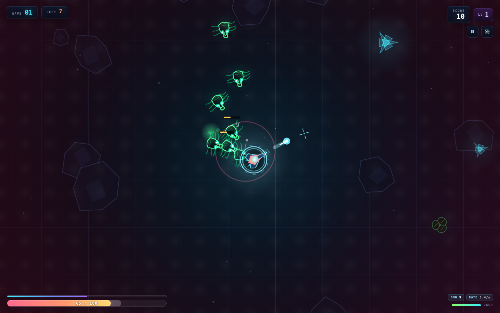
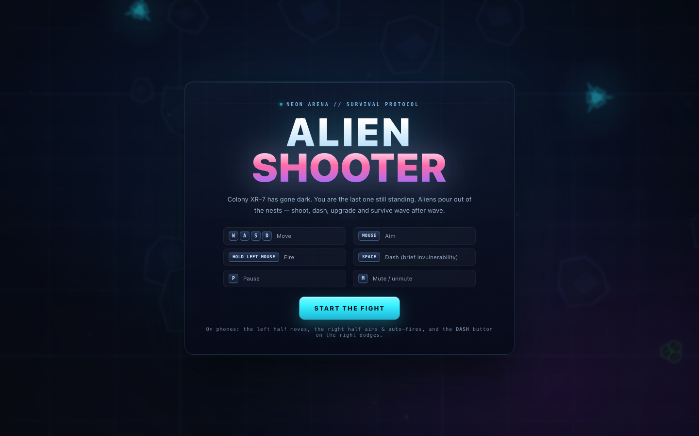
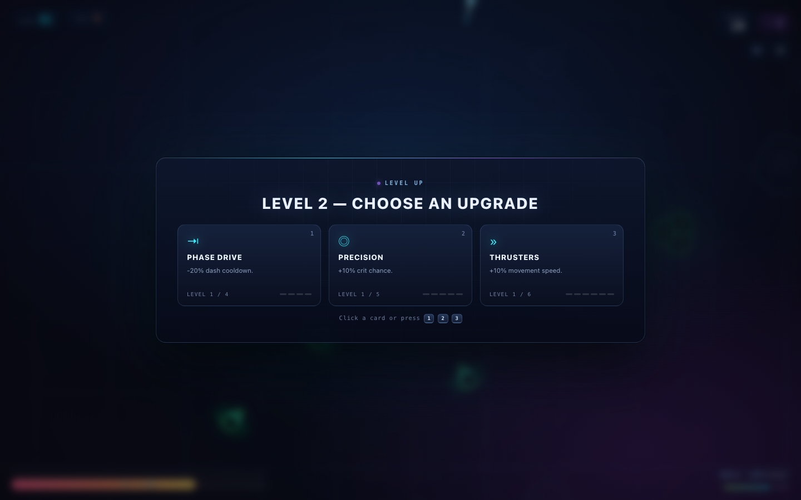
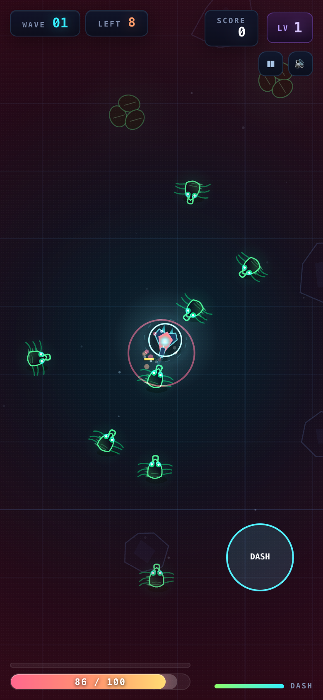
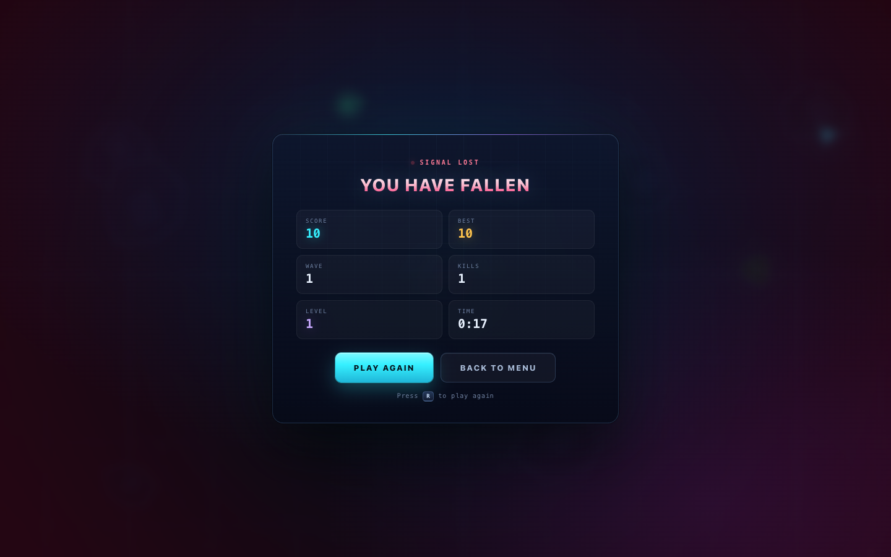

# ALIEN SHOOTER — Neon Arena

A top-down survival arena shooter that runs **entirely in the browser** — no install, no internet, no third-party libraries.

You are the last survivor of colony XR-7. Aliens pour out of the nests in waves. Shoot, dash, collect XP, pick upgrades, and stay alive as long as you can.



---

## Run the game

**Option 1 — open it directly:** double-click `index.html` (or drag it into Chrome / Safari / Edge / Firefox).

**Option 2 — serve it locally** (if your browser blocks local files):

```bash
cd games/alien-shooter
python3 -m http.server 8080
# open http://localhost:8080
```

No build step, no `npm install`.

---

## Controls

| Desktop | Action |
|---|---|
| `W` `A` `S` `D` / arrow keys | Move |
| Mouse | Aim |
| Hold left mouse button | Fire (auto-cycled) |
| `Space` | Dash — 0.3 s invulnerability, on a cooldown |
| `P` / `Esc` | Pause |
| `M` | Mute / unmute |
| `1` `2` `3` | Choose an upgrade on level up |
| `R` | Retry (on the game-over screen) |

**On phones / tablets:** the left half of the screen is a movement joystick, the right half is an aim joystick (hold to fire continuously), and the **DASH** button sits in the bottom-right corner. Pause ⏸ and mute 🔊 are in the top-right.

---

## Gameplay

- **Endless waves**, with difficulty ramping throughout: more aliens, more health, more speed.
- **5 enemy types:**
  - 🟢 **Crawler** — crawls straight at you; weak but numerous.
  - 🟡 **Skitter** — fast, zig-zagging, very hard to hit.
  - 🟣 **Spitter** — keeps its distance and spits acid (it charges up visibly before firing).
  - 🟠 **Brute** — tough, thick plating, splits into 2 Crawlers when killed.
  - 💗 **Boss** — every **5 waves**, with 4 attacks: radial bursts, a triple aimed volley, summoning minions, and a headlong charge at you.
- **XP & upgrades:** killing aliens drops XP; on level up you pick 1 of 3 random upgrades.
  There are **16 upgrades** in two groups: stat upgrades (damage, fire rate, multi-shot, piercing, crit, health, regen, move speed, XP magnet…) and rare upgrades (explosive rounds, dash shockwave, escort drone).
- **Scoring:** kills plus wave-clear bonuses. Your **best run** is stored in `localStorage`.
- **Tactics:** keep your distance, kill Spitters first, use dash to dodge shots and slip through crowds. Collect XP to level up — don't just stand and shoot.

---

## Screenshots

| | |
|---|---|
|  |  |
|  |  |
|  | |

## Project structure

```
alien-shooter/
├── index.html          # UI shell: title, HUD, pause, level-up, game over
├── css/style.css       # all neon/glass UI styling + mobile responsiveness
└── js/
    ├── core.js         # math, WebAudio synth engine, input (mouse/keyboard/touch), camera, particle FX
    ├── entities.js     # Player, the 5 alien types, AI, vector drawing, collision
    └── game.js         # game loop, wave director, upgrades, arena rendering, HUD
```

- **No dependencies, no WASM, no external image or audio assets** — everything is Canvas 2D vectors and sound synthesised through the Web Audio API.
- **Degrades gracefully on weak hardware:** drops scanlines/nebula and thins out particles when FPS < 44 (the `lowfx` class on `body`).
- **Deliberately no ES modules**, so it can run straight from `file://`.

## Balance tuning

The most useful knobs:

| To change | Edit |
|---|---|
| Each alien's health / speed / damage, XP dropped | `ENEMY_DEFS` in `js/entities.js` |
| Player starting stats (`damage`, `fireRate`, `maxHp`…) | `Player.reset()` in `js/entities.js` |
| Aliens per wave, spawn pacing, boss milestones | `startWave()` in `js/game.js` |
| The upgrade list | `UPGRADES` in `js/game.js` |

Good luck surviving longer than I did. 👾
