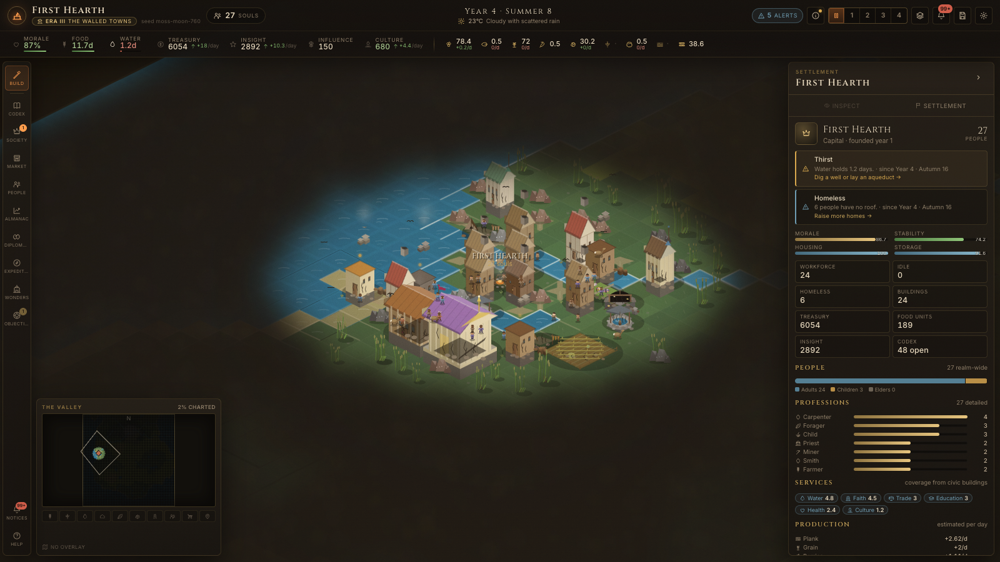

# First Hearth

> *One wanderer. An unnamed valley. A hearth. Everything else is history.*

**First Hearth** is a living-world civilization simulation that runs in your browser.
You begin with a single settler, a handful of berries and a lit fire in a procedurally
generated world. Over generations you raise a village, cultivate the soil, master fire and
iron, discover writing and steam and electricity, found new settlements, trade with rival
peoples — and discover what your civilisation costs the land that feeds it.

It is built as a *simulation first*: a deterministic, headless TypeScript core with a
Canvas 2D isometric world and a dense, readable interface on top.



*Year 4: a walled town of 27 souls, three eras in — fields, workshops, temples, and the roads that tie them together.*

More screenshots: [hero 1920](shots/first-hearth-hero-1920.png) · [the Codex](shots/first-hearth-codex-1920.png) · [1280×800 layout](shots/first-hearth-1280.png)

## Player-feedback fixes (round 2)

- **Lag / "1 FPS" fixed.** Root cause: the fog-of-war rebuilt a blurred 758k-pixel canvas (~392 ms) whenever exploration changed, and any 3 °C weather change rebuilt every baked terrain chunk. Fog is now incremental (soft hole-punching) and terrain invalidation is quantised to season/snow/freezing changes. Measured at Retina 2× with 160+ population: **60 fps, render p95 ~12 ms, no 400 ms hitches** (previously long tasks up to 414 ms every ~0.8 s). Autosave (27 ms serialise) moved to idle time; it also no longer stalls a frame.
- **Decisions no longer spam or soft-lock.** Decisions now arrive 60/50/42/… game days apart by era (20–30 s of real play at normal speed), at most **one pending** at a time, no serious events in the first month, and chained/scheduled events are handled by your council instead of opening another modal. Every decision also has a **Let it pass** escape, so a choice you cannot afford can never trap the game.
- **Real onboarding.** The welcome now leads into an 8-step, skippable **spotlight tour** (HUD, build menu, speed, codex, objectives, decisions) and a persistent **First Steps** checklist tracks camp → shelter → well → discovery → farm → five souls → granary. Replay both from Help (?) at any time; the tour now also appears for players loading an existing save who have not seen it.
- Retina terrain chunks are capped at a sane bake resolution with a DPR-aware memory budget; no more chunk-cache thrash at 2× (0 evictions measured).

## Status

First Hearth is feature-complete for a v1 release and verified end-to-end:

- **Simulation:** deterministic daily tick pipeline (16 systems), seeded worldgen (112×112), 54 resources, 93 buildings, 81 recipes, 95 discoveries, 45 events, 18 policies, 13 doctrines, 20 milestones, 20 achievements, 6 megaprojects, 14 sites, 3–5 AI neighbours, ecology/climate/disaster simulation.
- **Tests:** `npm test` → **84/84 passing** (7 files) across content integrity, determinism, save/load equivalence, economy invariants, early game, bootstrap regression, 400-day long runs.
- **Browser QA:** **62/62 checks passing**, zero console/page errors, all panels and overlays verified at 1600×900 and 1280×800, save→load and export→import round-trips exact, **60 fps at 4× speed with 140+ population**, ~2.0 ms per simulated day.
- **Balance (automated play, 5 seeds × 400 days):** no extinctions, era 1 by day 70–79, era 2 reachable, famine/water pressure remains a meaningful mid/late-game challenge.
- **Open known issues:** age-2 progression variance, late-game water infrastructure demands, minor UI truncation at narrow widths. See [QA report](docs/QA-REPORT.md).

Screenshots: [hero 1600](shots/first-hearth-hero-1600.png) · [hero 1920](shots/first-hearth-hero-1920.png) · [Codex](shots/first-hearth-codex-1920.png) · [1280×800](shots/first-hearth-1280.png) · [UI panel gallery](shots/ui-final-codex-1600.png)

## Play

```bash
npm install
npm run dev        # http://127.0.0.1:5280
npm run build      # typecheck + production build into dist/
npm run preview    # serve the production build
```

No accounts, no server, no external assets at runtime. Saves live in `localStorage`;
you can also export/import a save as JSON from the menu.

## What makes it a living world

- **Procedural continents** — domain-warped elevation, ridged mountains, D8 rivers carved
  into valleys, lakes, rain shadows, 10 biomes, surface and underground deposits,
  named regions, 12 discoverable sites and a hand-scored start location. Every seed is a
  different strategic puzzle.
- **Seasons, weather and climate** — 16-day seasons, storms, drought build-up, snow, and
  long-run climate drift driven by deforestation and industry.
- **Ecology that remembers** — forests regrow (and are felled), soil depletes and recovers,
  wildlife replenishes and can be hunted out, pollution spreads from smokestacks and
  poisons wells and lungs, biodiversity and beauty fall or rise with your choices.
- **People, not numbers** — named citizens with age, health, morale, needs, twelve skills,
  traits, education, jobs, homes, families, opinions and private thoughts. They eat, drink,
  learn, marry, have children, age, migrate and die. Large populations fold into aggregate
  cohorts while notable people stay fully simulated.
- **Deep production chains** — 54 resources and ~80 recipes: wood → planks → furniture;
  clay → brick and pottery; ore + charcoal → iron → steel → tools → machinery; grain →
  flour → bread; wool → cloth → clothes; coal → coke → steel; sand → glass; and more.
  Extraction depends on the land: forests, fertility, deposits, water, wildlife.
- **Discovery over a tech ladder** — 95 discoveries across six branches and seven eras,
  mutually exclusive paths, doctrine identities and serendipitous insight. Technologies
  change how systems work, not only what you can build.
- **Society and politics** — approval, stability, crime, four social classes, 16 policies,
  taxes, rations, work hours, festivals, culture and civilisation-defining creeds.
- **Events that grow out of state** — the director watches food days, housing, unemployment,
  pollution, drought, epidemics and neighbours, warns you with traceable causes, and offers
  decisions with real tradeoffs. Crises chain: drought → harvest failure → migration →
  housing crisis → unrest.
- **Trade, diplomacy and neighbours** — three to five AI civilisations with personalities,
  attitudes, offers, alliances and rare raids. Markets float prices; caravans move goods.
- **Automation** — governor settings fill jobs, reserve food, repair and trade for you as
  your civilisation scales. The joy is designing systems that run themselves.
- **History** — a generated chronicle, year almanacs, milestones, achievements, graphs and
  a world that carries the scars and monuments of what you did to it.

## Controls

| Input | Action |
|---|---|
| Drag / WASD | Pan camera |
| Mouse wheel | Zoom |
| Click | Select tile / building / citizen |
| B | Build menu |
| Space | Pause / resume |
| 1–4 | Simulation speed |
| T / S / M / P / C / D / E / W / O | Codex, Society, Market, People, Chronicle, Diplomacy, Expeditions, Wonders, Objectives |
| Esc | Close panel / cancel build |
| F | Focus capital |
| G | Toggle grid |

## Project layout

```
src/
  sim/                  deterministic simulation (no DOM, no rendering)
    types.ts            state & content schemas
    core.ts             shared helpers (stock, modifiers, conditions, tiles)
    tick.ts             daily system pipeline
    state.ts            new game, citizens, buildings, caches
    actions.ts          every player action, validated and costed
    save.ts             versioned save/load
    metrics.ts          metric provider for events/milestones/charts
    rng.ts              seeded sfc32 PRNG
    config.ts           balance rules and tunables
    world/              worldgen, noise, climate
    systems/world/      weather, ecology, disasters, exploration, neighbours
    systems/civ/        buildings, production, logistics, economy, jobs, population,
                        society, research, events, objectives
    content/            data packs: resources, biomes, buildings, recipes, techs,
                        policies, doctrines, eras, events, sites, milestones, people
  render/               Canvas 2D isometric renderer (terrain, sprites, FX, minimap)
  ui/                   DOM interface: HUD, panels, modals, charts, tooltips
  app.ts                clock, save/load, player actions, event bus
  main.ts               boot
tests/                  vitest suites (content, determinism, save/load, economy, long run)
tools/                  headless sim runner, screenshot harness, profiling
docs/                   design document, content authoring, architecture, QA report
```

## Verification

```bash
npm run typecheck
npm test                                  # content, determinism, save/load, economy, long-run
npx vite-node tools/simrun.ts -- --seed demo --days 400 --autoplay --verbose
node tools/shot.mjs --url http://127.0.0.1:5280 --out shots/game.png
```

The simulation is deterministic: the same seed and the same actions produce the same world,
state and history. Saves are versioned JSON; loading rebuilds only transient caches.

## Design

- [Game design](docs/DESIGN.md)
- [Architecture and engine contracts](docs/ARCHITECTURE.md)
- [Content authoring](docs/CONTENT-AUTHORING.md)

---

*First Hearth is an original game, engine and content set, built with TypeScript, Vite,
Canvas 2D and no game-engine dependency.*
